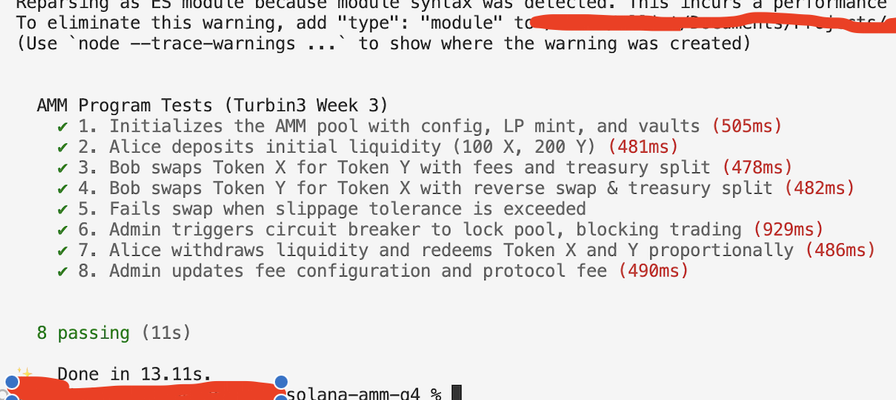
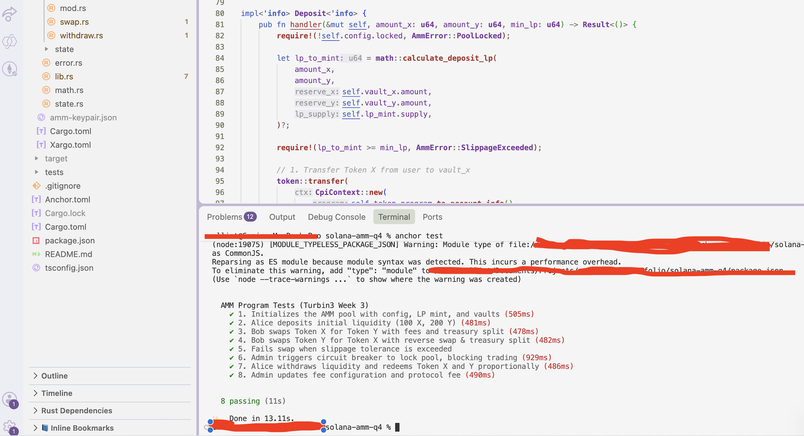

# Constant Product AMM (Turbin3 Week 3)

A production-grade Constant Product Automated Market Maker (CPMM) built on Solana using **Anchor 0.31.1**. This protocol enables trustless liquidity provision, decentralized token swaps, configurable fee routing to protocol treasuries, and circuit-breaker emergency pausing.

---

## 🏗️ Architecture & PDA Derivations

The program derives deterministic PDAs to isolate pool state, token custody, and LP mint authority:

```
solana-amm-q4/
├── programs/
│   └── amm/
│       └── src/
│           ├── instructions/
│           │   ├── initialize.rs
│           │   ├── deposit.rs
│           │   ├── withdraw.rs
│           │   ├── swap.rs
│           │   └── admin.rs
│           ├── state.rs
│           ├── math.rs
│           ├── error.rs
│           └── lib.rs
└── tests/
    └── amm.ts
```

### PDA Seeds
* **Config PDA**: `[b"config", seed.to_le_bytes().as_ref()]` — holds pool configuration, fee rates, treasury address, and circuit breaker state.
* **LP Mint PDA**: `[b"lp", config.key().as_ref()]` — pool-specific LP token mint where mint authority is the `config` PDA.
* **Vault X / Vault Y**: Associated Token Accounts (ATAs) for Mint X and Mint Y, owned by the `config` PDA.

---

## 📐 Extension Challenge #4: CPMM Math Without Libraries

To satisfy Extension Challenge #4, all AMM invariant mathematics are written from scratch in pure Rust (`src/math.rs`) without depending on external AMM or curve crates:

### 1. Invariant Curve
$$x \cdot y = k$$
where $x$ and $y$ are the active pool reserves for Token X and Token Y.

### 2. Initial Liquidity Provision
$$LP = \lfloor\sqrt{\Delta x \cdot \Delta y}\rfloor$$
Computed using an integer Newton-Raphson / Babylonian square root algorithm:
```rust
pub fn integer_sqrt(n: u128) -> u128 {
    if n == 0 { return 0; }
    let mut x0 = n / 2;
    if x0 == 0 { return 1; }
    let mut x1 = (x0 + n / x0) / 2;
    while x1 < x0 {
        x0 = x1;
        x1 = (x0 + n / x0) / 2;
    }
    x0
}
```

### 3. Subsequent Proportional Deposit
$$LP_{\text{minted}} = \min\left( \frac{\Delta x \cdot LP_{\text{total}}}{x}, \frac{\Delta y \cdot LP_{\text{total}}}{y} \right)$$

### 4. Proportional Withdrawal
$$\Delta x = \frac{LP_{\text{burned}} \cdot x}{LP_{\text{total}}}, \quad \Delta y = \frac{LP_{\text{burned}} \cdot y}{LP_{\text{total}}}$$

### 5. Swapping & Fee Structure
Given input $\Delta x$ and fee rates in basis points ($1 \text{ bps} = 0.01\%$):
* $\text{Total Fee} = \frac{\Delta x \cdot \text{Fee}_{\text{bps}}}{10000}$
* $\text{Protocol Fee} = \frac{\Delta x \cdot \text{ProtocolFee}_{\text{bps}}}{10000}$
* $\Delta x_{\text{effective}} = \Delta x - \text{Total Fee}$

The output is computed using constant product conservation:
$$\Delta y = \frac{\Delta x_{\text{effective}} \cdot y}{x + \Delta x_{\text{effective}}}$$

The protocol fee is transferred directly to the designated `treasury_token` account, while the remaining fee cut $(\text{Total Fee} - \text{Protocol Fee})$ compounds directly inside the pool vault to reward Liquidity Providers.

---

## 🛡️ Extension Challenge #5: Mitigating Downtime in DeFi Applications

During periods of severe Solana network congestion, cluster degradation, or external oracle outages, DeFi applications face severe liquidity, insolvency, and user experience risks. To achieve high resilience and mitigate downtime:

### 1. Graceful Degradation & Asymmetric Circuit Breakers
* **Problem**: When market volatility spikes or a dependency breaks, naive protocols freeze all operations, locking user capital and causing panic.
* **Mitigation**: Implement segmented circuit breakers (`lock` instruction). If the pool is locked:
  * `swap` and `deposit` are halted to protect against toxic flow or stale pricing.
  * **`withdraw` remains permanently accessible as an escape hatch**, ensuring users retain sovereign custody and can exit anytime without protocol insolvency risk.

### 2. Staked RPCs & Redundant Multi-Provider Failover
* **Problem**: Public and single-tenant RPC endpoints frequently drop transactions or rate-limit clients during high-throughput events.
* **Mitigation**: 
  * Deploy private **Staked RPC Nodes** (which receive priority block production access from validators).
  * Implement client-side connection pooling and automatic fallback routing across independent RPC infrastructure providers (e.g., Triton, Helius, QuickNode, Jito).

### 3. Dynamic Priority Fees & Compute Budget Optimization
* **Problem**: Fixed-fee transactions get dropped or starved out of validator transaction processing queues (SWQoS).
* **Mitigation**:
  * Integrate dynamic priority fee estimators (such as Helius/Jito priority fee APIs) to inspect recent slots and adjust micro-lamport prioritization fees.
  * Explicitly limit Compute Units (`SetComputeUnitLimit`) to the minimum required for the instruction to minimize validator scheduling penalty.

### 4. Direct Blockspace Inclusion via Jito Bundles
* **Problem**: Arbitrage and liquidation transactions submitted via the standard gossip network fail due to searcher competition and congestion.
* **Mitigation**: Route time-sensitive transactions through Jito block engines using atomic bundles, guaranteeing inclusion without mempool exposure or failed transaction fee waste.

---

## 🧪 Test Suite & Coverage

All instructions are covered by end-to-end integration tests in `tests/amm.ts`:

1. **`initialize`**: Config PDA derivation, LP mint creation, vault ATAs, fee parameters.
2. **`deposit` (Initial)**: Square root LP token calculation, vault reserve verification.
3. **`swap` (X ➔ Y)**: Curve execution, output validation, protocol fee transfer to treasury account.
4. **`swap` (Y ➔ X)**: Reverse curve execution, output validation, protocol fee transfer to treasury account.
5. **`swap` (Slippage Reversion)**: Verifies transaction reverts if output falls below `min_amount_out`.
6. **`admin lock` (Circuit Breaker)**: Confirms trading operations are blocked when pool is locked.
7. **`withdraw`**: Burns LP tokens, transfers proportional reserves back to provider.
8. **`update_config`**: Admin configuration updates for fees and treasury addresses.

### Test Results





### Running the Tests
```bash
cd solana-amm-q4
anchor test
```
